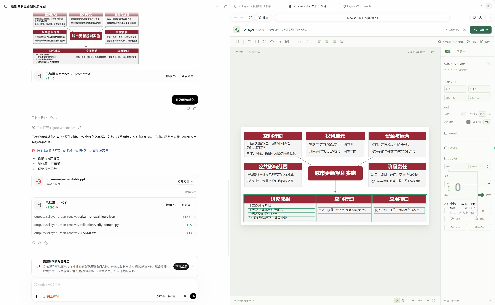
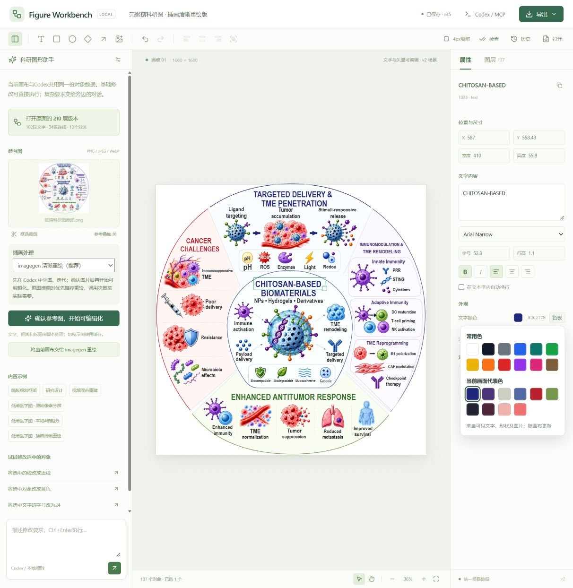

# SciLayer

[简体中文](README.md) | [English](README.en.md)

**把 ChatGPT / Codex ImageGen 生成的图片，以及其他科研参考图，拆成一个个可独立编辑的图层元素。**

Turn ChatGPT / Codex ImageGen figures and other images into individually editable layers.

SciLayer 是一个 **Codex Skill + 本地 MCP 图层编辑器**。把满意的图片交给 Codex，重建成可分别选取、拖动、修改和导出的文字、形状、箭头、图标及插画图层，在右侧画布继续编辑，并导出 PPTX、SVG、PNG、PSD 或 JSON。适合科研流程图、框图、机制图和结构图。

既可以使用 ChatGPT、Codex ImageGen 或其他工具生成的图片，也可以导入已有论文图、截图等参考图。**无需先重新生图**。这里的“拆层”是由 Codex 理解画面后重建独立对象，复杂插画裁为图片图层；并非恢复原图隐藏的 PSD 图层，也不是把所有细节自动变成矢量。

> 0.5.0 · Codex 优先 · 本地服务 · Apache-2.0 · 允许商业使用

## 看看实际操作

**在 Codex 中把参考图变成可编辑对象。** 左侧用自然语言发起转换，右侧画布分别选取文字、框线与箭头，继续修改并导出。



**复杂科研图也可分层处理。** 文字与线框可分别编辑，插画保留为独立图片图层；属性栏提供文字设置、常用色与画面代表色。



第二张为早期开发界面，仍显示旧名称 Figure Workbench 和已移除的内置示例入口；当前产品名称为 SciLayer。截图用于展示操作，不会作为内置示例加载到画布。

## 从一张图片到可编辑图层

| 原图元素 | 转换后的独立图层 | 可以做什么 |
| --- | --- | --- |
| 文字与标注 | 原生文字对象 | 改字、字体、字号、颜色和位置 |
| 边框与基础形状 | 原生形状或支持的矢量路径 | 改尺寸、描边、实线/虚线、渐变和圆角 |
| 箭头与连线 | 独立连接对象或路径 | 移动端点、调整走向、线型与颜色 |
| 简单图标 | 支持的语义模板与矢量路径 | 缩放、调色、修改线宽；需核对匹配结果 |
| 复杂插画 | 单独裁出的图片图层 | 移动、缩放、替换；插画内部细节仍是位图 |

也支持从文字开始：校准必要信息与绘图提示词，使用 Codex 内置 imagegen 生成易分层的参考图。你决定何时转换、是否高清化，以及是否将导出图再次交给 imagegen 迭代。**ChatGPT 图片是支持的输入来源，当前 Skill 与 MCP 的集成宿主是 Codex。**

## 工作流

```text
绘图需求 → 必要问题与提示词校准 → Codex imagegen → 图片与侧栏预览
已有图片 ────────────────────────────────────────────┘
                                                     ↓ 用户选择
                                                清晰度初检
                                                     ↓
                      保留原图 ← 用户决定 → imagegen 清晰重绘
                                                     ↓ 用户发起转换
               可编辑图层 ← 对照原图重建 ← 选定的参考图
                   ↓
        侧栏编辑 → PPTX / SVG / PNG / PSD / JSON
```

- **提示词校准**：默认白背景，模块化插画、独立线框、文字、箭头四类元素齐全，减少重叠与细碎纹理。只追问会影响科学含义或结构的缺失信息。
- **自由生图与迭代**：不设“一次生成、一次重绘”这样的次数限制；仅生成不会自动转换。导出图也可再交给 imagegen，是否重新转换由用户决定。
- **先检测，再选择高清化**：尺寸与边缘统计结合 Codex 视觉检查；即使默认推荐 imagegen，也不会自动高清化。
- **原生对象编辑**：文字、形状、自由曲线、箭头、图层组合；实线/虚线；线宽、常用色和画面代表色；渐变色标与方向；圆角开关与半径。
- **同步编辑**：MCP 与本地界面共用场景 JSON，版本检查与冲突合并避免覆盖同时发生的修改。
- **图标矢量化**：文档、地球、放大镜等有限语义模板的匹配预览；可将多个图标拼版，用户选择 imagegen 清晰化后再切回识别。
- **从空白开始**：不附带内置案例、论文图片或个人工作数据。

## 安装：推荐在 Codex 中使用

需要 **Node.js 22+、npm、Git、Codex CLI**。图像生成需要当前 Codex 会话可用的 imagegen 能力；SciLayer 本身不包含生图模型、不需要另购本工具额度，也不保证宿主图像生成服务免费。

```powershell
git clone https://github.com/Su0tar/SciLayer.git
cd SciLayer
npm ci
npm run build
npm run install:codex
```

安装程序将 `skills/scilayer` 复制到 `~/.agents/skills/scilayer`，并用 Codex CLI 注册 `figure-workbench` stdio MCP。保留此克隆目录，MCP 配置指向其中的 `mcp/server.mjs`；移动目录后重新运行安装。为兼容早期版本，MCP 标识仍是 `figure-workbench`，产品和 skill 名称是 SciLayer。

安装后刷新 MCP 或重启 Codex，再输入 `$scilayer`。当前会话的工具列表可能需要重载才能看到新增工具。可用 `codex mcp list` 检查注册，用 `npm run doctor` 检查本地依赖和构建。

旧版 Codex 若使用 `~/.codex/skills`，可指定技能安装位置：

```powershell
node scripts/install.mjs --skills-dir "$HOME/.codex/skills"
```

只安装 skill、不修改 MCP 配置：

```powershell
node scripts/install.mjs --skill-only
```

手动注册 MCP（在克隆目录执行）：

```powershell
codex mcp add figure-workbench -- node "$PWD/mcp/server.mjs"
```

复制 skill 目录不会自动安装 Node 依赖。更新仓库后运行 `npm ci`、`npm run build`、`npm run install:codex`。请阅读并使用你信任的仓库副本。

## 在 Codex 中使用

直接将现有图片拆层：

```text
$scilayer 将这张 ChatGPT / Codex ImageGen 生成的科研图拆成可编辑图层。
文字、边框、箭头分别重建，复杂插画保留为独立图片图层。
保留原图布局，在右侧打开，导出PPTX和JSON。若不清晰，先建议，不自动重绘。
```

从想法开始生图：

```text
$scilayer 帮我画一张科研流程图，用于中文汇报PPT，横向16:9。
节点是样本采集、质量控制、特征提取、结果验证，按顺序连接。
每个模块用一个简洁示意图标，文字必须逐字保留。
先生成参考图，在右侧打开，我确认后再做可编辑化。
```

已有图片：

```text
$scilayer 使用当前对话刚生成的最新图片，先检查清晰度，
需要高清化时给我选项，不要自动重绘。
```

满意后：

```text
这张图可以了，开始可编辑化，保留原图布局，导出PPTX和JSON。
```

继续编辑：

```text
将选中的箭头改为虚线，框的圆角半径设为16，填充改为蓝绿渐变。
```

skill 调用 `open_editor`；支持 MCP Apps 的宿主可渲染 UI 资源，Codex 也可将返回的本地地址打开为右侧浏览器标签。原生 MCP App 的承载方式取决于 Codex 版本；本地浏览器模式同样可用。

**最新图片**优先来自当前会话已知的 imagegen 输出路径。另一个对话的图片只有在附件或文件路径确实可访问时才能导入，不能自动读取所有历史对话。设置参考预览不等于转换，也不会清空已有画布。

## 本地打开

```powershell
npm start
```

浏览器打开 [本地画布](http://127.0.0.1:4317/?panel=1)。Windows 也可双击 `start-workbench.cmd`，它会在需要时启动本地服务并打开系统浏览器窗口。

无需 Codex，仍可使用图层编辑、导入 JSON、参考图裁剪和导出。普通网页不能自行使用 Codex 内置 imagegen，也不能自动向 Codex 发消息：“交给 Codex”会复制指令，需粘贴回对话。推荐在 Codex 中生成和重建；独立网页可选择配置自己的兼容视觉 API（见 `.env.example` 和界面设置），调用费用和数据传输由该服务决定。

服务只绑定 `127.0.0.1`。项目状态和历史记录保存在本地 `data/`；导出与图集输出保存在 `output/`。这些目录不进入 Git。将参考图交给 imagegen 或外部模型时，该图会发送给所用模型服务；本地编辑与导出本身不上传图片。不要将服务直接暴露到公网。

## MCP 与数据格式

| 任务 | 主要工具 |
| --- | --- |
| 打开侧栏、读取状态 | `open_editor`, `get_canvas`, `get_reference_image` |
| 提示与流程 | `get_generation_brief`, `get_workflow_plan`, `set_workflow` |
| 参考图和清晰度 | `import_reference_image`, `assess_image_quality` |
| 重建与修改 | `get_reconstruction_schema`, `replace_canvas`, `update_objects`, `add_objects`, `delete_objects` |
| 图标 | `vectorize_icons`, `prepare_icon_atlas`, `vectorize_icon_atlas` |
| 核验与交付 | `check_layout`, `get_canvas_preview`, `export_figure` |

场景格式详见 [SCENE_FORMAT.md](SCENE_FORMAT.md)。写入需要读取时的 revision；冲突时重新读取并合并。

## 当前边界

- **由 Codex 视觉理解结构，工具执行保存与导出**。当前并非离开模型就能对任意科研图进行完整自动语义分割的算法，也未内置通用 OCR 或本地超分模型。
- 清晰度检测是启发式初检，不保证小字正确、插画完整或科学内容可信。imagegen 清晰重绘可能改变细节，需对照原图。
- PPTX 的文字、基础形状、支持的路径、线条与渐变是原生对象；复杂插画为可移动、可替换的位图，内部细节不能逐个编辑。
- SVG 保留文字与矢量对象；PNG 是平面预览。PSD 保留图层和文字数据，但非文字图层使用栅格缓存，不是 Photoshop 原生矢量形状层。
- 图标匹配只有有限模板，必须检查预览；不等同于任意图片的高保真矢量描摹。
- Windows 是当前主要验证环境；导出字体受本机可用字体影响。无需安装 PowerPoint 也可导出 PPTX。

## 开发与验证

```powershell
npm run build
npm test
npm run doctor
```

测试覆盖真实 HTTP 鉴权、版本冲突与持久化、stdio MCP 握手与 UI 资源、并发状态、原生导出、渐变/圆角、路径、图标图集和清晰度检测。测试图形为独立构造的几何夹具，不依赖个人源图。开发模式运行 `npm run dev`。

## 许可与署名

原始代码和 skill 使用 [Apache License 2.0](LICENSE.md)：**允许商业和非商业使用、修改与分发**，并包含协议规定的专利授权。分发时须遵守协议，包括附带许可证、保留适用的版权及署名信息和 [NOTICE](NOTICE)，并在修改过的文件中显著说明修改。完整条件以许可证为准。

建议项目介绍注明：`SciLayer by Suyang Yuan — https://github.com/Su0tar/SciLayer`。第三方组件保留各自许可，见 [THIRD_PARTY_NOTICES.md](THIRD_PARTY_NOTICES.md)；本软件许可不自动改变用户图片或导出作品的权利归属。

作者：**Suyang Yuan（袁溯阳）** · [GitHub / Su0tar](https://github.com/Su0tar)。

Codex skill 的发现与调用参见 [官方技能文档](https://learn.chatgpt.com/docs/build-skills)。SciLayer 为独立项目，与 FigureLab 无隶属关系。
